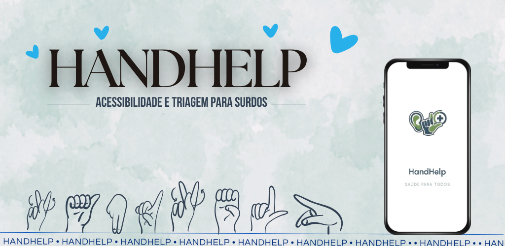

<div align="center">

# HandHelp

### Protótipo acessível para apoiar a triagem de pessoas surdas em serviços de saúde

<a href="https://github.com/StellaKarolinaNunes/Projeto_Integrador_Handhelp_versao_1.0">
  
</a>

<br>


<br><br>

<p align="center">
  <a href="https://handhelp.netlify.app/">
    
  </a>
  <a href="https://github.com/StellaKarolinaNunes/Projeto_Integrador_Handhelp_versao_1.0">
    
  </a>
</p>

</div>

---

## Sobre o projeto

O **HandHelp** é um protótipo acadêmico desenvolvido em Flutter para apoiar a comunicação durante a triagem de pessoas surdas em unidades básicas de saúde.

A proposta foi criada no contexto do Projeto Integrador do curso de Ciência da Computação do IFPA, com foco em acessibilidade, inclusão e aplicação de tecnologia assistiva em saúde.

A aplicação utiliza uma interface visual, fluxos guiados e recursos de apoio em Libras para ajudar o paciente a registrar informações básicas sobre sintomas, dor e necessidade de atendimento. Ao final, as informações podem ser organizadas em um resumo que auxilia a comunicação com a equipe de saúde.

> Este repositório representa a versão inicial do HandHelp, desenvolvida como protótipo acadêmico. O aplicativo não substitui atendimento médico, diagnóstico profissional, intérprete de Libras ou serviços de emergência.

---

## Objetivo

O HandHelp busca reduzir barreiras de comunicação que podem surgir durante o início de um atendimento em saúde.

Em muitos contextos, pessoas surdas podem enfrentar dificuldades para explicar sintomas, localização da dor, intensidade ou duração de um problema quando não há recursos acessíveis disponíveis.

O projeto propõe uma interface multimodal para apoiar esse primeiro contato, utilizando elementos visuais, navegação guiada, recursos de Libras e formulários simplificados.

A proposta também busca reforçar conceitos de:

* acessibilidade digital;
* tecnologia assistiva;
* desenvolvimento mobile com Flutter;
* interfaces inclusivas;
* experiência do usuário;
* organização de fluxos de triagem;
* comunicação visual em aplicações de saúde.

---

## Problema

A comunicação é uma etapa essencial em qualquer atendimento de saúde.

Quando não há intérprete disponível, linguagem acessível ou recursos visuais adequados, o paciente surdo pode ter dificuldade para explicar o que está sentindo. Isso pode aumentar a ansiedade, reduzir a autonomia e dificultar a coleta inicial de informações.

O HandHelp foi idealizado para apoiar a triagem por meio de uma ferramenta visual e guiada, ajudando o paciente a registrar dados importantes antes da comunicação com a equipe de saúde.

---

## Solução desenvolvida

A solução consiste em um aplicativo Flutter que orienta o usuário por etapas relacionadas à triagem básica.

O fluxo permite selecionar sintomas, registrar localização de dor, indicar intensidade e acessar vídeos ou recursos de apoio em Libras. Ao final, a aplicação organiza as informações inseridas para facilitar a apresentação durante o atendimento.

A versão atual funciona como protótipo de interface e demonstração de fluxo, com foco em acessibilidade, navegação e experiência do usuário.

---

## Funcionalidades

### Recursos disponíveis no protótipo

* **Tela inicial acessível:** apresentação visual do aplicativo e início do fluxo de triagem.
* **Escolha do tipo de atendimento:** organização inicial do atendimento desejado.
* **Seleção de sintomas:** registro de informações básicas sobre o que o usuário está sentindo.
* **Localização da dor:** apoio visual para identificar regiões do corpo.
* **Intensidade da dor:** registro da intensidade por meio de interface guiada.
* **Fluxo de triagem:** navegação estruturada entre as etapas principais.
* **Geração de resumo textual:** organização das informações coletadas durante o fluxo.
* **Vídeos em Libras:** apoio visual em etapas do aplicativo.
* **Execução web:** possibilidade de visualizar o protótipo pelo navegador.
* **Interface responsiva:** adaptação da aplicação para diferentes tamanhos de tela.

### Estrutura prevista para evolução

* acompanhamento de sinais vitais;
* histórico de consultas;
* módulo gestacional;
* proteção por PIN ou biometria;
* persistência local de dados;
* geração de relatórios estruturados;
* funcionamento offline completo;
* integração com APIs e serviços externos.

---

## Tecnologias utilizadas

| Tecnologia   | Aplicação no projeto                             |
| ------------ | ------------------------------------------------ |
| Flutter      | Desenvolvimento da interface multiplataforma     |
| Dart         | Linguagem principal da aplicação                 |
| Flutter Web  | Execução do protótipo no navegador               |
| VLibras      | Referência e apoio para acessibilidade em Libras |
| Google Fonts | Tipografia utilizada na interface                |
| Git          | Controle de versão                               |
| GitHub       | Hospedagem do repositório                        |
| Netlify      | Publicação da versão web demonstrativa           |

---

## Destaques técnicos

* Protótipo voltado para acessibilidade em saúde;
* Interface visual com foco em pessoas surdas;
* Fluxo guiado para coleta inicial de sintomas;
* Uso de recursos multimodais, como texto, imagens e vídeos;
* Estrutura Flutter multiplataforma;
* Organização inicial de telas por funcionalidade;
* Demonstração web publicada para apresentação acadêmica;
* Base preparada para evolução futura com arquitetura mais escalável;
* Projeto alinhado a temas de inclusão, acessibilidade e tecnologia assistiva.

---

## Fluxo principal da aplicação

```text
Usuário inicia o HandHelp
        │
        ▼
Tela inicial e apresentação do aplicativo
        │
        ▼
Escolha do atendimento
        │
        ▼
Triagem guiada
        │
        ├── Seleção de sintomas
        ├── Localização da dor
        ├── Intensidade da dor
        ├── Informações adicionais
        └── Apoio visual em Libras
        │
        ▼
Geração de resumo das informações
        │
        ▼
Apresentação do resumo ao profissional de saúde
```

---

## Demonstração web

<div align="center">

<a href="https://handhelp.netlify.app/">
  
</a>

<br><br>

<a href="https://handhelp.netlify.app/">
  
</a>

</div>

> As imagens e a demonstração pública possuem finalidade acadêmica e não devem ser utilizadas para inserir dados médicos reais.

---

## Estrutura do projeto

```bash
Projeto_Integrador_Handhelp_versao_1.0/
├── assets/
│   ├── fonts/
│   │   └── urbanist/
│   │
│   ├── images/
│   │   ├── BANNER_1.png
│   │   ├── deploy.png
│   │   └── imagens-e-ícones-do-app/
│   │
│   ├── videos/
│   │   └── vídeos-de-apoio-em-libras/
│   │
│   └── vlibras/
│       └── recursos-de-acessibilidade/
│
├── lib/
│   ├── main.dart
│   ├── home.dart
│   ├── EscolhaAtendi.dart
│   ├── Triagem_real.dart
│   ├── PaginaSintoma.dart
│   ├── sintoma.dart
│   ├── intensidade_dor.dart
│   ├── barra_intensidade.dart
│   ├── PaginaInt.dart
│   ├── GeraTexto.dart
│   ├── colocavideos.dart
│   ├── videos.dart
│   ├── Rotina.dart
│   ├── values.dart
│   └── PaginaLogo.dart
│
├── test/
│   └── widget_test.dart
│
├── android/
├── ios/
├── linux/
├── macos/
├── web/
├── windows/
│
├── analysis_options.yaml
├── pubspec.yaml
├── pubspec.lock
├── LICENSE
└── README.md
```

> Pastas geradas automaticamente pelo Flutter, como `build/` e `.dart_tool/`, não aparecem na estrutura porque não devem ser enviadas ao Git.

---

## Como executar o projeto

### Pré-requisitos

Antes de iniciar, é necessário ter instalado:

* Flutter SDK;
* Dart SDK compatível com a versão do Flutter;
* Git;
* Android Studio ou VS Code;
* extensões Flutter e Dart instaladas;
* emulador Android configurado, navegador compatível ou dispositivo físico conectado.

### 1. Clone o repositório

```bash
git clone https://github.com/StellaKarolinaNunes/Projeto_Integrador_Handhelp_versao_1.0.git
```

### 2. Acesse a pasta do projeto

```bash
cd Projeto_Integrador_Handhelp_versao_1.0
```

### 3. Verifique o ambiente Flutter

```bash
flutter doctor
```

### 4. Instale as dependências

```bash
flutter pub get
```

### 5. Execute a aplicação

```bash
flutter run
```

### 6. Execute no navegador

```bash
flutter run -d chrome
```

### 7. Liste dispositivos disponíveis

```bash
flutter devices
```

---

## Testes e build

### Executar testes

```bash
flutter test
```

### Analisar o código

```bash
flutter analyze
```

### Gerar APK

```bash
flutter build apk
```

### Gerar build web

```bash
flutter build web
```

### Gerar App Bundle

```bash
flutter build appbundle
```

---

## Roadmap

### Organização e arquitetura

* [x] Protótipo inicial de triagem;
* [x] Estrutura Flutter multiplataforma;
* [x] Telas para sintomas, dor e fluxo de atendimento;
* [x] Recursos visuais e vídeos de apoio;
* [x] Demonstração web publicada;
* [ ] Aplicar Clean Architecture;
* [ ] Organizar melhor pastas por módulos e responsabilidades;
* [ ] Aplicar princípios SOLID;
* [ ] Padronizar nomes de arquivos e classes.

### Estado e persistência

* [ ] Implementar gerenciamento de estado com Provider, Bloc ou Riverpod;
* [ ] Adicionar armazenamento local para dados do usuário;
* [ ] Criar histórico de triagens;
* [ ] Implementar cache offline;
* [ ] Adicionar banco local com SQLite ou Hive;
* [ ] Implementar proteção local por PIN.

### Acessibilidade e saúde

* [ ] Ampliar o acervo de vídeos em Libras;
* [ ] Melhorar semântica para leitores de tela;
* [ ] Criar modo de alto contraste;
* [ ] Adicionar ajustes de tamanho de texto;
* [ ] Refinar textos e instruções em Libras;
* [ ] Criar resumo estruturado mais completo para profissionais.

### Qualidade e evolução

* [ ] Criar testes unitários;
* [ ] Criar testes de widgets;
* [ ] Criar testes de integração;
* [ ] Melhorar tratamento de erros;
* [ ] Adicionar validação de campos;
* [ ] Criar documentação técnica mais detalhada;
* [ ] Evoluir a versão acadêmica para uma arquitetura de produção.

---

## Contribuição

Contribuições são bem-vindas, especialmente em acessibilidade, Flutter, UX inclusiva, Libras, organização de arquitetura e testes.

```bash
# Faça um fork do projeto no GitHub

# Clone o seu fork
git clone https://github.com/SEU-USUARIO/Projeto_Integrador_Handhelp_versao_1.0.git

# Entre na pasta do projeto
cd Projeto_Integrador_Handhelp_versao_1.0

# Crie uma branch para sua alteração
git checkout -b feature/nova-funcionalidade

# Instale as dependências
flutter pub get

# Execute os testes
flutter test

# Adicione as alterações
git add .

# Crie um commit descritivo
git commit -m "feat: adiciona melhoria de acessibilidade"

# Envie a branch para o GitHub
git push origin feature/nova-funcionalidade
```

Depois, abra um Pull Request explicando:

* o objetivo da alteração;
* quais telas ou componentes foram modificados;
* como a funcionalidade foi testada;
* se houve impacto na acessibilidade;
* se foram adicionados recursos visuais ou vídeos em Libras.

### Diretrizes

* Preserve a finalidade inclusiva do projeto;
* Evite linguagem médica que sugira diagnóstico automático;
* Não adicione dados reais de pacientes;
* Nunca envie credenciais, chaves ou informações privadas;
* Considere acessibilidade em toda alteração de interface;
* Mantenha textos claros, simples e objetivos;
* Utilize nomes compreensíveis para telas, widgets e variáveis;
* Atualize o README quando houver mudanças importantes;
* Teste o fluxo completo antes de abrir um Pull Request.

---

## Licença

Este projeto está licenciado sob a [Licença MIT](LICENSE).

```text
MIT License

Você pode usar, modificar e distribuir este projeto,
desde que mantenha os créditos e a referência ao repositório original.
```

---

## Créditos

### Desenvolvimento e contexto acadêmico

* **Desenvolvimento principal:** [Stella Karolina Nunes](https://github.com/StellaKarolinaNunes)
* **Instituição:** Instituto Federal de Educação, Ciência e Tecnologia do Pará — IFPA Campus Tucuruí
* **Curso:** Bacharelado em Ciência da Computação
* **Projeto:** Projeto Integrador
* **Professor orientador:** [Alex Santos de Oliveira](https://github.com/alex2024383)

### Acessibilidade e recursos

* **Apoio em Libras:** [Aline Cely](https://github.com/AlineCely)
* **Referência de acessibilidade em Libras:** [VLibras](https://www.gov.br/governodigital/pt-br/vlibras)
* **Framework:** [Flutter](https://flutter.dev/)
* **Linguagem:** [Dart](https://dart.dev/)
* **Tipografia:** [Google Fonts — Urbanist](https://fonts.google.com/specimen/Urbanist)
* **Publicação web:** [Netlify](https://www.netlify.com/)
* **Controle de versão:** Git e GitHub
* **Badges:** [Shields.io](https://shields.io/)
